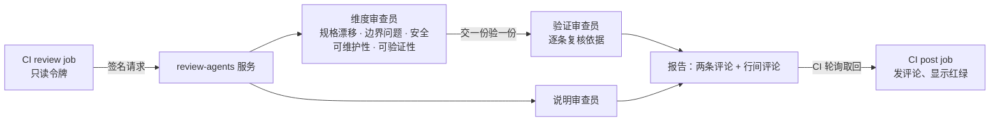

# review-agents

一个可自部署的多 agent PR 审查服务。每次打开 PR 或推送新提交，仓库的 CI 把 PR 交给服务；几个维度的审查员同时找问题，验证审查员逐条复核，程序核对每条依据，最后生成两条评论：

1. **改动说明**：这个 PR 为什么改、改了什么、影响到哪里。
2. **审查结果**：按级别分组的发现（🔴 阻断、🟡 重要、🔵 健壮性、⚪ 细节），🔴 / 🟡 同时发成行间评论。

服务不保存 GitHub 凭据，也不写 GitHub：它只拿 CI 给的只读令牌读代码，评论由 CI 自己发。

## 怎么工作



- 一次审查最长 30 分钟，维度审查员最晚第 20 分钟交卷。
- 发布的每条 🔴 / 🟡 都带程序核对过的依据：引用的规则原文确实在所写的位置，代码位置真实存在。
- CI 只有在审查做完、而且没有 🔴 时才显示绿色。拦不拦合入，在 GitHub 的分支保护里把这个检查设成必须通过。

## 部署

用 Docker Compose 运行，服务监听 `127.0.0.1:8080`，数据（SQLite 和仓库镜像）放在 `review-data` 卷里：

```bash
docker compose up -d --build
curl http://127.0.0.1:8080/healthz
```

服务的设置全部来自 `REVIEW_AGENTS_` 开头的环境变量，嵌套项用 `__` 连接，写在 `compose.yaml` 旁边的 `.env` 文件里（这个文件不进 git）。至少要设：

| 变量 | 作用 |
| --- | --- |
| `REVIEW_AGENTS_SHARED_SECRET` | 和 CI 共用的签名密钥，至少 32 个字符 |
| `REVIEW_AGENTS_FINDER_MODEL__BASE_URL` | 找问题用的模型服务，任何 OpenAI 兼容接口 |
| `REVIEW_AGENTS_FINDER_MODEL__MODEL` | 模型名 |
| `REVIEW_AGENTS_FINDER_MODEL__API_KEY` | 模型服务的 key |

可选：`REVIEW_AGENTS_VERIFIER_MODEL__*` 配一个更强的验证模型（不配时由找问题模型验证）；`REVIEW_AGENTS_TOKENS_PER_REVIEW` 每次审查的 token 上限（默认 1,500,000）；`REVIEW_AGENTS_OBSERVABILITY__*` 接入 OpenTelemetry。全部设置见 `src/review_agents/config.py`。

服务要能被 GitHub Actions 访问到：公网地址加 HTTPS。

## 接入 CI

1. 把 `ci/review-agents.yml` 复制到被审查仓库的 `.github/workflows/`，把里面的 `<commit>` 换成本仓库的一个完整提交 SHA。
2. 在被审查仓库加两个 secret：`REVIEW_AGENTS_URL`（服务地址）和 `REVIEW_AGENTS_SECRET`（同 `REVIEW_AGENTS_SHARED_SECRET`）。
3. 想在红的时候拦住合入：Settings → Branches（或 Rules），把 `post` 设成必须通过的检查。

模板分两个 job：`review` 只有读权限，它的令牌交给服务；`post` 只多一项写评论的权限，令牌不离开 GitHub。模板不检出、不执行 PR 的代码，所以 fork 来的 PR 也能用 `pull_request_target` 安全地审。协作者在 PR 下评论 `/review` 可以手动重审。

## 仓库配置

被审查的仓库可以在**默认分支**上放一份 `.github/review-agents.yml`。配置只从默认分支读，PR 改不了自己的审查方式。

```yaml
language: zh            # zh | en：审查员写评论用的语言
mode: standard          # quick | standard | deep
dimensions:             # 至少开 1 个
  spec_drift: true
  edge_cases: true
  security: true
  maintainability: true
  verifiability: true
specs: [docs/specs/**]  # 规格文档
skip_paths: [fixtures/**]   # 只能在默认的跳过规则上追加
limits:                 # 只能调小
  review_minutes: 30
  nits_per_report: 5
```

配置写错时整份回退到默认值，原因写进审查记录。

## 开发

需要 Python 3.12 和 [uv](https://docs.astral.sh/uv/)：

```bash
uv sync
uv run pytest
uv run ruff check . && uv run ruff format --check .
uv run mypy
```

提交信息格式为 `<type>(<scope>): <summary>`。装上本仓库的 git hooks，提交和推送前会检查提交信息、密钥和强推：

```bash
bash scripts/install-hooks.sh
```

用 Claude Code 开发时，`.claude/settings.json` 会加载 `pstack` 插件（来自 `cursor/plugins`）。
