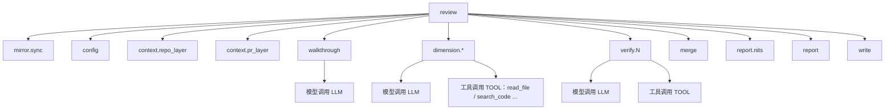

# 可观测性

一次审查对应一条 OpenTelemetry trace，发到 Langfuse、LangSmith、Phoenix 或任意 OTLP 接收端。默认关闭。决策见 D-042，架构见架构方案 §15。

## 记录什么



- **根 span `review`**：审查编号、仓库、PR 号、head 提交、触发事件、策略。`session.id` 为 `仓库#PR`，同一个 PR 的各轮审查归在一个会话里。
- **节点 span**：名字和 `steps` 表的 `node` 一致。节点失败时 span 标为错误，错误信息与 `steps.error` 相同。
- **模型调用**：由 OpenInference 的 LangChain 插件记录，包括模型名和 token 数（输入、输出、缓存命中）。挂在发起调用的审查员或验证员下面。
- **工具调用**：工具名、是否出错；`full` 档另记参数和返回内容。
- **`summaries`**：后台生成仓库模块摘要，单独一条 trace，不属于任何一次审查。
- `steps.trace_id` 记录这条 trace 的 ID，可以从数据库直接找到对应的 trace。

## 隐私

| 档位 | 保留 | 不保留 |
|---|---|---|
| `metadata`（默认） | span 名称、耗时、状态与错误的开头、模型名、token 数、工具名、`review.*`、`session.id` | 代码、提示词、模型输出、工具参数和返回内容 |
| `full` | 以上全部，加上提示词、模型输出、工具参数和返回内容 | — |

- 两档都在导出前统一过滤：每个字符串经过 `redact.py` 的 REDACT 去掉密钥（服务自己的密钥、GitHub token、`sk-` key、bearer/basic 凭据、URL 里的密码）。
- `metadata` 档只放行上表列出的字段，其余一律丢弃；同时让 OpenInference 不采集输入输出。
- 错误信息：`full` 档保留全文；`metadata` 档只保留第一个「: 」之前的部分（如异常类型），因为异常文字可能引用模型发来的参数或工具读到的内容。完整原因看 `steps.error`（同一个 `trace_id`）。两档都经过 REDACT。

## 接入配置

都通过环境变量设置。`HEADERS` 取 JSON 对象，其中的值视为密钥，会加入 REDACT。

| 变量 | 说明 |
|---|---|
| `REVIEW_AGENTS_OBSERVABILITY__ENABLED` | `true` 开启 |
| `REVIEW_AGENTS_OBSERVABILITY__CONTENT` | `metadata`（默认）或 `full` |
| `REVIEW_AGENTS_OBSERVABILITY__EXPORTER` | `langfuse` / `langsmith` / `phoenix` / `otlp`（默认） |
| `REVIEW_AGENTS_OBSERVABILITY__ENDPOINT` | OTLP 基址；服务会补上 `/v1/traces`。langsmith、phoenix 可不填 |
| `REVIEW_AGENTS_OBSERVABILITY__HEADERS` | 认证头，JSON |

### Langfuse

```sh
REVIEW_AGENTS_OBSERVABILITY__ENABLED=true
REVIEW_AGENTS_OBSERVABILITY__EXPORTER=langfuse
# 按账号所在区域：US 为 us.cloud.langfuse.com，EU 为 cloud.langfuse.com
REVIEW_AGENTS_OBSERVABILITY__ENDPOINT=https://us.cloud.langfuse.com/api/public/otel
# Basic 认证：base64("<Public Key>:<Secret Key>")
REVIEW_AGENTS_OBSERVABILITY__HEADERS='{"Authorization": "Basic <base64>"}'
```

在 Claude Code 云端环境里不设 `HEADERS`：在环境的 Network secrets 里给 `us.cloud.langfuse.com` 加一条 Basic 凭据（用户名填 Public Key，密码填 Secret Key），由网络代理注入。

### LangSmith

```sh
REVIEW_AGENTS_OBSERVABILITY__ENABLED=true
REVIEW_AGENTS_OBSERVABILITY__EXPORTER=langsmith
# 默认 https://api.smith.langchain.com/otel；EU 区或自部署时填 ENDPOINT
REVIEW_AGENTS_OBSERVABILITY__HEADERS='{"x-api-key": "<key>", "Langsmith-Project": "review-agents"}'
```

### Phoenix

```sh
REVIEW_AGENTS_OBSERVABILITY__ENABLED=true
REVIEW_AGENTS_OBSERVABILITY__EXPORTER=phoenix
# 默认 http://localhost:6006；Phoenix Cloud 时填 ENDPOINT 和 {"Authorization": "Bearer <key>"}
```

### 通用 OTLP

```sh
REVIEW_AGENTS_OBSERVABILITY__ENABLED=true
REVIEW_AGENTS_OBSERVABILITY__EXPORTER=otlp
REVIEW_AGENTS_OBSERVABILITY__ENDPOINT=http://collector:4318
```

## 排查

**从一条可疑发现追到源头**（需开启观测，`full` 档才能看到读过的内容）：

1. 查 `findings` 表里这条发现的 `review_id`，再查 `steps` 表里这次审查的 `trace_id`。
2. 在平台里打开这条 trace，找到写出这条发现的 `dimension.*` span（发现的 `primary_dimension`）。
3. 展开看它的模型调用（提示词、回复）和工具调用（读过哪些文件、搜了什么）；验证结论在对应的 `verify.N` 下面。

**不开观测时定位失败的节点**：

```sql
SELECT node, status, error, note FROM steps WHERE review_id = ? ORDER BY id;
```

每个节点不管成功还是失败都有一行；中途抛异常结束的审查，最后一行就是出错的节点，`error` 写明原因。没有任何节点行的失败审查（例如 token 已失效、被新推送取代），原因在 `reviews.error`。审查员和验证员没交卷时，对应的 `dimension.*`、`walkthrough`、`verify.N` 行写明原因。

## 常见问题

- **平台里看不到 trace**：先看服务日志有没有导出失败的记录；再核对 `ENDPOINT` 的区域和路径（Langfuse 要带 `/api/public/otel`），以及认证头。span 批量发送（每次最多 32 个，`full` 档的 span 较大），审查结束后几秒内到达；服务停止时会发完剩下的。
- **只有 `summaries`、没有 `review`**：后台摘要和审查是两条 trace，按时间找审查那条。
- **trace 里没有提示词**：默认 `metadata` 档不记录内容，要看请设 `CONTENT=full`。
